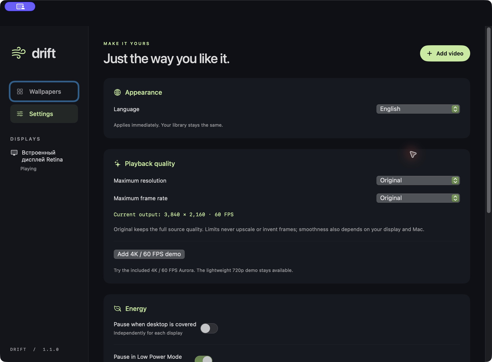

<div align="center">

# Drift

### A little motion. A quieter desktop.

Native video wallpapers for macOS, with a local library, independent display controls and thoughtful energy management.


[](LICENSE)

[Download](https://github.com/Frininww/drift-wallpaper/releases/latest) · [Русский](docs/README.ru.md) · [Performance](docs/PERFORMANCE.md) · [Report an issue](https://github.com/Frininww/drift-wallpaper/issues)



</div>

## Features

- **Your videos, on your desktop.** Import local MP4, MOV and M4V files supported by macOS. H.264 and HEVC are recommended.
- **English by default, Russian when you want it.** Switch in **Settings → Appearance → Language**. The interface, statuses, alerts and menu bar actions update immediately; the choice persists.
- **Original source quality, including 4K and high FPS.** Choose Original, 1080p, 1440p or 4K resolution limits, and Original, 24, 30, 60 or 120 FPS limits. Actual output depends on your source, display and Mac.
- **Two original Aurora demos.** Start with a lightweight 720p / 24 FPS loop, or add the 4K / 60 FPS version from Playback quality settings.
- **Independent display playback.** The selected video plays on enabled monitors, with a separate player and automatic occlusion pause for each one.
- **Energy-aware pauses.** Pauses on display/system sleep, inactive sessions, serious thermal pressure and, by default, Low Power Mode. Battery pause is optional.
- **Native controls.** SwiftUI library, menu bar pause/quit, fill/fit scaling, persistent preferences and opt-in launch at login.
- **Silent, local and private.** Only video enters the playback queue. No accounts, analytics, ads, network calls or third-party package dependencies.

## Install

**Requirements:** macOS 13 Ventura or later, Apple Silicon or Intel.

1. Download `Drift-universal.zip` from [Releases](https://github.com/Frininww/drift-wallpaper/releases/latest).
2. Unzip it and move **Drift.app** to **Applications**.
3. Open Drift. The lightweight Aurora demo is added automatically.
4. Click **Add video**, choose a local file, then click its library card.

**Signing:** release builds are ad-hoc signed and **not notarized by Apple**. macOS may block the first launch. After verifying the source and checksum, allow it in **System Settings → Privacy & Security → Open Anyway**, or build from source. There is no need to disable Gatekeeper globally.

The release includes `SHA256SUMS.txt`. Place it beside the archive and verify:

```sh
shasum -a 256 -c SHA256SUMS.txt
```

Screen Recording and Accessibility permissions are not required. Imported videos are copied into Drift’s local library; your originals stay untouched.

## Controls

| Action | Where |
| --- | --- |
| Apply a wallpaper | Click its card in Your collection |
| Pause / resume | Cover button or Drift’s menu bar icon |
| Switch English / Russian | Settings → Appearance → Language |
| Change resolution / FPS | Settings → Playback quality |
| Add the 4K / 60 FPS demo | Settings → Playback quality → Add 4K / 60 FPS demo |
| Change fill / fit | Settings → Display |
| Disable one monitor | Settings → Display → its switch |
| Launch at login | Settings → Startup; macOS may require approval |
| Remove an imported video | Right-click its card → Remove from library |
| Reveal the system wallpaper | Turn wallpapers off in Settings or the menu bar |
| Stop Drift completely | Menu bar → Quit Drift |

Closing the library window keeps Drift in the menu bar. Drift places video underneath desktop icons and above your system wallpaper; it does not replace the system wallpaper setting. Quitting reveals the original wallpaper.

## Resolution and frame rate

**Original** is the default for both controls. It retains the encoded resolution and cadence without adding a video compositor. A 4K / 60 or 120 FPS source can therefore keep its detail and frame rate when your Mac and display support it. Original does not impose a 4K or 120 FPS cap.

The other choices are **maximums**, not upscalers or frame interpolation. Selecting 4K / 120 FPS for a 720p / 24 FPS video still produces 720p / 24 FPS. Effective output is shown in settings. Resolution limits preserve orientation and aspect ratio; FPS limits do not change playback speed.

Lower limits use an AVFoundation video composition when necessary. They may add processing and do not guarantee lower decoder cost; for energy savings, an efficiently encoded source is preferable. There is no offline transcoding, custom frame loop or fixed CPU/RAM/battery promise. See [performance and verification](docs/PERFORMANCE.md).

## Build from source

Requires **Xcode 16+**, its command line tools and **Swift 6+**. No package downloads are needed.

```sh
git clone https://github.com/Frininww/drift-wallpaper.git
cd drift-wallpaper
swift test
bash scripts/build-app.sh --universal
open dist/Drift.app
```

Omit `--universal` to build for your current architecture. Open `Package.swift` in Xcode for development. The script packages the executable, video resources, English/Russian translations and icon, then signs and verifies the `.app`. A bare executable from `.build` needs its resource bundle alongside it.

To use your own signing identity:

```sh
SIGNING_IDENTITY="Developer ID Application: Your Name (TEAMID)" bash scripts/build-app.sh --universal
```

Developer ID signing and notarization require your own Apple Developer account. Notarization is a separate step.

## Project layout

```text
Sources/
  Drift/                 Native UI, localization, import, windows and video pipeline
  DriftCore/             Pause policy, quality planning, models and atomic storage
Tests/
  DriftCoreTests/        Pause, migration, persistence and quality planning
  DriftMediaTests/       Real 4K60 metadata, rendered output and translations
Packaging/              App Info.plist
scripts/                App build, icon and original demo generation
docs/                   Russian README, performance notes and screenshots
docs/workflows/         Optional GitHub Actions templates
```

**Data:** `~/Library/Application Support/Drift/`. `library.json` stores the library and preferences; `Wallpapers/` holds imported copies. Writes are atomic. Existing 1.0 libraries migrate without losing their selection or settings. Damaged manifests are backed up before recovery.

GitHub Actions templates for tests, universal builds and releases are included under [docs/workflows](docs/workflows). To enable them, move the files into `.github/workflows/` and push with a credential that has `workflow` permission. They are inactive until installed.

## Limits

- Desktop wallpapers only: the lock screen and macOS screen saver are not modified.
- Local videos playable by AVFoundation only. Web pages, streams, DRM, GIF and Wallpaper Engine projects are unsupported.
- AppKit determines occlusion. Transparent windows, Spaces and Stage Manager may affect when automatic pause occurs.
- Each enabled display has its own player. More displays can increase decoder work and memory use.
- Pausing retains the current frame and player resources for quick resumption. Turn wallpapers off or quit to release them.
- Actual quality, smoothness and energy use depend on the video, Mac, display and macOS version. A frame-rate option cannot exceed the physical refresh rate of your display.

## Contributing and license

See [CONTRIBUTING.md](CONTRIBUTING.md) and the [changelog](CHANGELOG.md). Code, icon and both original Aurora videos are [MIT licensed](LICENSE). No third-party wallpaper assets are included.
