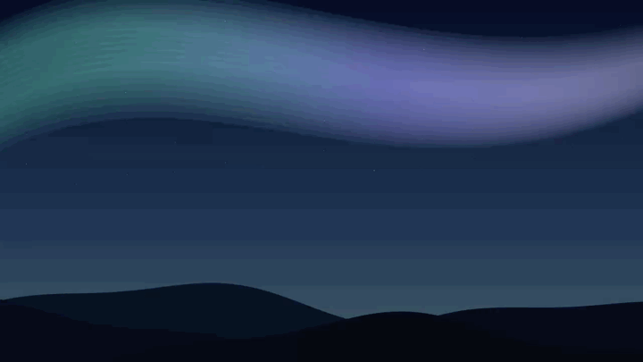
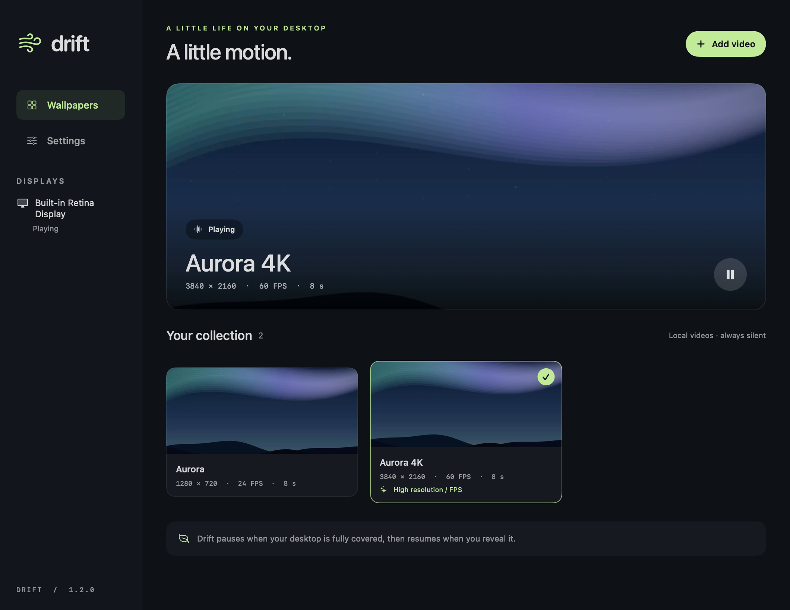

<div align="center">

# Drift

### A little motion. A quieter desktop.

Native video wallpapers for macOS, with a local library, independent display controls and thoughtful energy management.


[](LICENSE)

[**Download**](https://github.com/Frininww/drift-wallpaper/releases/latest) · [Русский](docs/README.ru.md) · [Performance](docs/PERFORMANCE.md) · [Report an issue](https://github.com/Frininww/drift-wallpaper/issues)



<sub>The bundled Aurora loop, as Drift plays it on your desktop.</sub>

</div>

## Why Drift

- **It stays out of your way.** Playback pauses when a window covers the desktop, when the display sleeps, on serious thermal pressure and in Low Power Mode.
- **It is native.** SwiftUI and AVFoundation, no Electron, no web view, no third-party packages.
- **It is private.** No account, no analytics, no ads, no network calls. Your videos are copied into a local library and your originals are never touched.
- **It is simple.** Add a video, click its card, done. One player per display, each with its own switch.

**Measured on one machine:** with the bundled 720p / 24 FPS Aurora playing on a MacBook Pro (Apple M4 Pro, macOS 26.6.2), Drift used about 2–3% of one CPU core and about 45 MB of memory over a short `top` sample (about 15 seconds). That is a single quick check, not a benchmark; see [performance notes](docs/PERFORMANCE.md) for how to measure your own setup.



## How Drift compares

| | Drift | Wallpaper Engine | Plash | macOS built-in |
| --- | --- | --- | --- | --- |
| Runs on macOS | Yes | No (Windows) | Yes | Yes |
| Your own video files | Yes | Yes (on Windows) | No, shows web pages | No, Apple's aerials and dynamic wallpapers only |

Drift does one thing: local video as a desktop wallpaper on macOS. It does not play web pages, GIFs or Wallpaper Engine projects (see [Limits](#limits)).

## Features

- **Your videos, on your desktop.** Import local MP4, MOV and M4V files supported by macOS. H.264 and HEVC are recommended.
- **English by default, Russian when you want it.** Switch in **Settings → Appearance → Language**. The interface, statuses, alerts and menu bar actions update immediately; the choice persists.
- **Original source quality, including 4K and high FPS.** Choose Original, 1080p, 1440p or 4K resolution limits, and Original, 24, 30, 60 or 120 FPS limits. Actual output depends on your source, display and Mac.
- **Two original Aurora demos.** Start with a lightweight 720p / 24 FPS loop, or add the 4K / 60 FPS version from Playback quality settings.
- **Independent display playback.** The selected video plays on enabled monitors, with a separate player and automatic occlusion pause for each one.
- **Energy-aware pauses.** Pauses on display/system sleep, inactive sessions, serious thermal pressure and, by default, Low Power Mode. Battery pause is optional.
- **Lock Screen / system still image.** Apply a chosen video frame or photo as the system background, optionally follow wallpaper selection, and restore the previous image. macOS controls how this appears on the Lock Screen; this is not an independent animated Lock Screen.
- **One wallpaper owner.** Opening another copy activates the running Drift instead of stacking players. Upgrading retires older Drift releases before starting new wallpaper windows.
- **Native controls.** SwiftUI library, menu bar pause/quit, fill/fit scaling, persistent preferences and opt-in launch at login.
- **Silent, local and private.** Only video enters the playback queue. No accounts, analytics, ads, network calls or third-party package dependencies.

## Install

**Requirements:** macOS 13 Ventura or later, Apple Silicon or Intel.

1. Download `Drift-universal.zip` from [Releases](https://github.com/Frininww/drift-wallpaper/releases/latest).
2. Unzip it and drag **Drift.app** into **Applications**.
3. Open Drift. If macOS refuses, follow [the next section](#macos-wont-open-drift) (it takes about 30 seconds).
4. The lightweight Aurora demo is added automatically. Click **Add video** to import your own, then click its card to apply it.

Screen Recording and Accessibility permissions are not required.

### macOS won't open Drift

Release builds are ad-hoc signed and **not notarized by Apple** (notarization needs a paid Apple Developer account). On the first launch macOS Gatekeeper may say that Drift "cannot be opened" or "could not be verified". That is expected for an unnotarized app, and it is a one-time step.

**Option 1: allow it in System Settings (recommended)**

1. Try to open Drift once and close the warning with **Done** (or **OK**).
2. Open **System Settings → Privacy & Security**.
3. Scroll down to the **Security** section. You will see a line saying that "Drift" was blocked.
4. Click **Open Anyway** and confirm with your password or Touch ID.
5. Open Drift again and click **Open** in the final dialog.

On macOS 15 Sequoia and later, the old right-click → **Open** shortcut no longer bypasses this check, so use the steps above. On macOS 13 and 14, right-clicking Drift.app and choosing **Open** also works.

**Option 2: clear the download flag in Terminal**

If you have checked the checksum below and trust the file, remove the quarantine flag macOS puts on downloads:

```sh
xattr -dr com.apple.quarantine /Applications/Drift.app
```

This affects only Drift.app. You do not need to turn Gatekeeper off globally, and you should not.

**Option 3: build it yourself**

[Build from source](#build-from-source) produces a copy signed on your own Mac, which Gatekeeper does not block.

### Verify the download

Each release includes `SHA256SUMS.txt`. Put it beside the archive and run:

```sh
shasum -a 256 -c SHA256SUMS.txt
```

You should see `Drift-universal.zip: OK`.

## Controls

| Action | Where |
| --- | --- |
| Apply a wallpaper | Click its card in Your collection |
| Pause / resume | Cover button or Drift’s menu bar icon |
| Switch English / Russian | Settings → Appearance → Language |
| Change resolution / FPS | Settings → Playback quality |
| Add the 4K / 60 FPS demo | Settings → Playback quality → Add 4K / 60 FPS demo |
| Set a system / Lock Screen still | Settings → Lock Screen & system background |
| Change fill / fit | Settings → Display |
| Disable one monitor | Settings → Display → its switch |
| Launch at login | Settings → Startup; macOS may require approval |
| Remove an imported video | Right-click its card → Remove from library |
| Reveal the system wallpaper | Turn wallpapers off in Settings or the menu bar |
| Stop Drift completely | Menu bar → Quit Drift |

Closing the library window keeps Drift in the menu bar. Video plays underneath desktop icons and above the system picture. Quitting reveals the current system picture, including a still you may have applied through Drift's system-background controls.

## Details

<details>
<summary><b>Lock Screen and system background</b></summary>

In **Settings → Lock Screen & system background**, choose a moment with the frame slider and click **Apply video frame**, or use **Choose image…** for a photo. The action sets a static desktop picture on the connected displays' current spaces using [NSWorkspace's supported image API](https://developer.apple.com/documentation/appkit/nsworkspace/setdesktopimageurl(_:for:options:)). macOS may also show that image behind its secure Lock Screen.

**This is a shared system still image, not a separate animated Lock Screen.** It also changes the desktop picture underneath Drift. Lock/login visuals, FileVault, aerial animation and other spaces remain under macOS control. See [Apple's Wallpaper settings](https://support.apple.com/guide/mac-help/mchlp1103/mac). Drift does not modify loginwindow, replace system aerial assets, install a privileged helper or weaken system security.

Enable **Follow the selected wallpaper with a still image** to apply the first frame when the selected video changes. Sync is off by default. The static image remains after quitting. **Restore previous system image** turns sync off and restores image URLs/options where available. It leaves a newer picture selected outside Drift untouched and retains restoration records for disconnected displays. Restoring an image cannot reconstruct a previous dynamic/aerial/shuffle configuration; use Wallpaper settings for those modes.

Drift adds no confirmation dialog for these image actions or for handing off between its own copies. Standard macOS trust and file-selection dialogs remain under macOS control.

</details>

<details>
<summary><b>Preventing stacked wallpapers</b></summary>

All 1.2+ copies share a per-user kernel file lock. A second launch opens the existing library and exits before creating a player or desktop window. Startup also retires legacy Drift copies with the app's exact bundle identifier; apps with other identifiers are not terminated. Renderer teardown is final: canceled loads cannot recreate a stopped window, and old layers and queues are detached before replacement.

</details>

<details>
<summary><b>Resolution and frame rate</b></summary>

**Original** is the default for both controls. It retains the encoded resolution and cadence without adding a video compositor. A 4K / 60 or 120 FPS source can therefore keep its detail and frame rate when your Mac and display support it. Original does not impose a 4K or 120 FPS cap.

The other choices are **maximums**, not upscalers or frame interpolation. Selecting 4K / 120 FPS for a 720p / 24 FPS video still produces 720p / 24 FPS. Effective output is shown in settings. Resolution limits preserve orientation and aspect ratio; FPS limits do not change playback speed.

Lower limits use an AVFoundation video composition when necessary. They may add processing and do not guarantee lower decoder cost; for energy savings, an efficiently encoded source is preferable. There is no offline transcoding, custom frame loop or fixed CPU/RAM/battery promise. See [performance and verification](docs/PERFORMANCE.md).

</details>

## Troubleshooting

| Problem | What to try |
| --- | --- |
| "Drift cannot be opened" / "could not be verified" | See [macOS won't open Drift](#macos-wont-open-drift). |
| Nothing plays on the desktop | Check that wallpapers are not turned off or paused in the menu bar icon, and that your Mac is not in Low Power Mode (Drift pauses there by default). |
| Video does not import | Use MP4, MOV or M4V encoded with H.264 or HEVC. Web streams, DRM-protected files and GIFs are unsupported. |
| Playback stutters | Choose a lower resolution or FPS limit in **Settings → Playback quality**, or use a shorter 1080p H.264/HEVC loop. More displays mean more decoder work, so disable unused ones in **Settings → Display**. |
| It paused by itself | That is the energy policy at work: a window covers the display, the Mac is asleep or hot, or Low Power Mode is on. See [Performance](docs/PERFORMANCE.md). |
| Desktop picture changed after quitting | You used the system-background still. Use **Restore previous system image** in Settings, or choose a picture in macOS Wallpaper settings. |
| Something else | [Open an issue](https://github.com/Frininww/drift-wallpaper/issues/new) with your Mac model, macOS version, and the video's codec and size. |

## Uninstall

1. If you applied a system still image, open Drift and click **Restore previous system image** first.
2. Turn off **Launch at login** in Drift's Settings (or remove Drift in **System Settings → General → Login Items**).
3. Quit Drift from its menu bar icon and move **Drift.app** to the Trash.
4. Optional: delete your library and settings at `~/Library/Application Support/Drift/`.

## Build from source

Requires **Xcode 16+**, its command line tools and **Swift 6+**. No package downloads are needed.

```sh
git clone https://github.com/Frininww/drift-wallpaper.git
cd drift-wallpaper
swift test
bash scripts/build-app.sh --universal
open dist/Drift.app
```

Omit `--universal` to build for your current architecture. Open `Package.swift` in Xcode for development. The script packages the executable, video resources, English/Russian translations and icon, then signs and verifies the `.app`. A bare executable from `.build` needs its resource bundle alongside it.

To use your own signing identity:

```sh
SIGNING_IDENTITY="Developer ID Application: Your Name (TEAMID)" bash scripts/build-app.sh --universal
```

Developer ID signing and notarization require your own Apple Developer account. Notarization is a separate step.

## Project layout

```text
Sources/
  Drift/                 Native UI, localization, import, windows and video pipeline
  DriftCore/             Pause policy, quality planning, models and atomic storage
Tests/
  DriftCoreTests/        Pause, migration, persistence and quality planning
  DriftMediaTests/       Real 4K60 metadata, rendered output and translations
Packaging/              App Info.plist
scripts/                App build, icon and original demo generation
docs/                   Russian README, performance notes and screenshots
docs/workflows/         Optional GitHub Actions templates
```

**Data:** `~/Library/Application Support/Drift/`. `library.json` stores the library and preferences; `Wallpapers/` holds imported copies. Writes are atomic. Existing 1.0 libraries migrate without losing their selection or settings. Damaged manifests are backed up before recovery.

`SystemBackground/` holds cached display-sized PNGs and an atomic restoration journal. Original image URLs/options are saved before system changes; pending entries permit recovery after an interrupted apply. Stills are cached and generated on demand, not on every video frame. `instance.lock` is released by the kernel when its owning process exits or crashes.

GitHub Actions templates for tests, universal builds and releases are included under [docs/workflows](docs/workflows). To enable them, move the files into `.github/workflows/` and push with a credential that has `workflow` permission. They are inactive until installed.

## Limits

- No independent animated Lock Screen or custom screen saver. System-image actions may affect the Lock Screen through macOS's shared wallpaper behavior, not by drawing over the secure screen.
- Local videos playable by AVFoundation only. Web pages, streams, DRM, GIF and Wallpaper Engine projects are unsupported.
- AppKit determines occlusion. Transparent windows, Spaces and Stage Manager may affect when automatic pause occurs.
- Each enabled display has its own player. More displays can increase decoder work and memory use.
- Pausing retains the current frame and player resources for quick resumption. Turn wallpapers off or quit to release them.
- Actual quality, smoothness and energy use depend on the video, Mac, display and macOS version. A frame-rate option cannot exceed the physical refresh rate of your display.

## Contributing and license

See [CONTRIBUTING.md](CONTRIBUTING.md) and the [changelog](CHANGELOG.md). Code, icon and both original Aurora videos are [MIT licensed](LICENSE). No third-party wallpaper assets are included.
